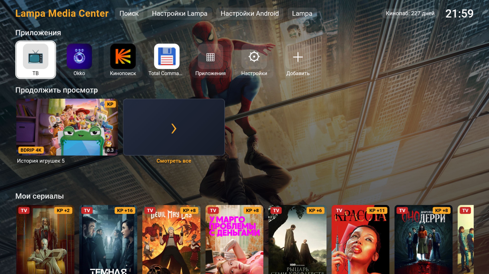
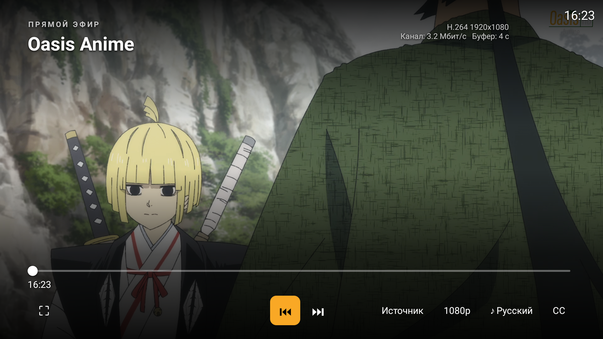
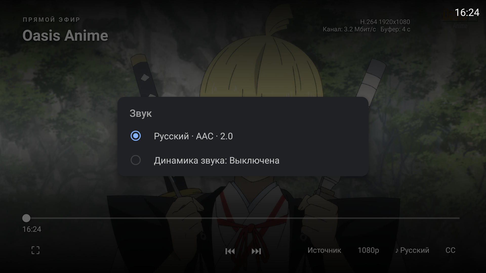

# LMPC HomeMedia и Android TV

> **Альфа-версия.** APK, HomeMedia и связка подключаемых сервисов находятся в активной разработке. Установка, сборка, обновление и первый запуск могут проходить с ошибками и требовать ручной настройки зависимостей. Возможны сбои воспроизведения и синхронизации; совместимость со всеми приставками и серверными окружениями не подтверждена. Перед обновлением сохраняйте настройки и резервные копии. Успешные отдельные проверки не означают завершённую приёмку всего медиaцентра.

Медиацентр LMPC — производный проект на базе [Lampac NextGen (GitHub)](https://github.com/lampac-nextgen/lampac). Здесь опубликованы модуль HomeMedia и Android-клиент; серверное ядро Lampac является отдельным исходным проектом.

Android-приложение LMPC Media Center — форк [lampa-app/LAMPA (GitHub)](https://github.com/lampa-app/LAMPA).

**[Открыть исходники APK — папка LAMPA/ в ветке master](https://gitverse.ru/Lepi4/lampa-home-module/content/master/LAMPA)** · [код приложения](https://gitverse.ru/Lepi4/lampa-home-module/content/master/LAMPA/app/src) · [инструкция по сборке](ANDROID-SOURCE.md).

Лицензирование: [PolyForm Noncommercial 1.0.0](LICENSE.md) для самостоятельных материалов Lepi4. Разрешены некоммерческое использование, копирование, изменение и распространение. [Область действия и лицензии стороннего кода](LICENSE-SCOPE.md).

Публичный пакет LMPC содержит мод HomeMedia для Lampac, исходники Android-клиента и APK-сборку. Сборки публикуются в альфа-статусе.

## Что входит в медиaцентр

| Компонент | За что отвечает |
| --- | --- |
| Android APK, вариант `mc` | Домашний экран Android TV, запуск приложений, навигация пультом, интерфейс выбора профиля и просмотра каталога, проигрывание видео и ТВ. Может быть выбран лаунчером по умолчанию. |
| Сервер Lampac + HomeMedia | Каталоги и внешние источники, профили и права доступа, серверное хранение прогресса/таймкодов, истории и коллекций, синхронизация между клиентами, подготовка ссылок для плеера. |
| [Channel Manager](https://gitverse.ru/Lepi4/lmpc-channel-manager) | Каналы и их источники, M3U, XMLTV/EPG, приоритеты и резервирование, буферизация и дополнительная обработка ТВ-потоков. Может работать отдельным сервисом либо рядом с Lampac в одном контейнере. |
| TorrServer | Получение и передача торрент-потоков клиентскому плееру. Это отдельный сервис, который может быть установлен рядом с Lampac. |

Tvheadend — сторонний сервис: HomeMedia только проксирует его интерфейс по относительному пути; Tvheadend сохраняет собственную авторизацию, а LMPC не обновляет и не настраивает его.

[Подробно: возможности APK, функции сервера и их взаимодействие](FEATURES.md).

## Скриншоты APK

Реальные снимки интерфейса от 28 октября 2026 года. В более новых сборках оформление и состав разделов могут отличаться; контент на экране зависит от подключённых источников и профиля.

Домашний экран: приложения и ленты контента.



ТВ-плеер APK: канал, параметры потока и управление. Каналы и потоки предоставляет Channel Manager, а изображение и управление — Android-клиент.



Выбор звуковой дорожки и клиентские настройки звука.



APK и сервер работают вместе: приложение показывает профиль и отправляет позицию просмотра, а HomeMedia хранит данные и предоставляет их другим устройствам. Channel Manager формирует телевизионный поток, который проигрывает APK. Для внешних каталогов и платных источников требуются свои доступы и подписки.

## Настройки через веб-панель

Основные настройки медиaцентра доступны с компьютера или телефона в браузере: `http://<адрес-Lampac>:9118/home` (при другом порте используйте свой адрес). Для административных разделов требуется вход с правами администратора. Настройки хранятся на сервере; подключённые APK-клиенты получают относящиеся к ним параметры при загрузке и обновлении данных.

- Зрители, профили, права и настройки устройств.
- Состояние синхронизации и базы, диагностика и серверные резервные копии.
- Подключение KinoPub, импорт коллекций, настройки YouTube и его профилей/каналов.
- Адрес TorrServer, подключение Channel Manager и параметры ТВ-раздела.
- Прокси для поддерживаемых источников, дополнительные каталоги и оформление.
- Зарегистрированные службы и поддерживаемые операции обновления/отката; набор действий зависит от установленных компонентов и настроек worker.

В полной установке из этой панели также доступны интерфейсы локальных сервисов, например Channel Manager по относительному пути `/home/services/channel-manager/`. Управление самим Channel Manager — источниками, каналами, EPG и буферизацией — выполняется в его веб-панели. Назначение APK лаунчером по умолчанию остаётся настройкой Android.

## Установка серверного модуля

Нужен Lampac с установленным HomeMedia и включённым локальным `/home` worker. На сервере откройте `/home`, затем выберите загрузку пакета HomeMedia и примените обновление. Без браузера:

```bash
python3 deploy/deploy-module.py \
  --url http://192.168.1.80:9118 \
  --profile-id u_default \
  --package release/2026.11.12.3/homemedia.tar.gz
```

Скрипт получает короткий администраторский сеанс, загружает пакет, ждёт проверку совместимости, запускает штатную замену и ждёт результат. Worker создаёт резервную копию перед заменой; откат выполняется кнопкой `rollback` в панели. Для подготовки без применения используйте `--no-apply`.

Прямой монтаж исходников нужен только для ручной установки: распакуйте содержимое `server-mod/HomeMedia` в `/opt/lampac/mods/HomeMedia`, сохраните `database/`, затем перезапустите `lampac.service`. Этот способ не создаёт резервную копию автоматически, поэтому для обычного обновления используйте пакет и worker.

## Android

Готовая сборка: `release/2026.11.12.3/LMPC-1.16.41-1159.apk`.

```bash
adb install -r release/2026.11.12.3/LMPC-1.16.41-1159.apk
```

**[Исходный код APK находится в LAMPA/](LAMPA/)**: код приложения, ресурсы и файлы Gradle опубликованы вместе с медиасерверным модулем. [Происхождение кода, состав исходников и сборка](ANDROID-SOURCE.md).

Для сборки flavor `mc` требуется JDK 17:

```bash
cd LAMPA
./gradlew assembleMcRelease -PappVersionCode=1159 -PappVersionName=1.16.41
```

Подпись и keystore намеренно не входят в публичный пакет. Не публикуйте `.env`, токены, cookies, базы данных или резервные копии.

## Автообновление

Проверку версий можно включить в панели для компонентов, у которых задан официальный источник. Применение HomeMedia остаётся ручным: сначала загружается проверенный пакет, затем worker делает резервную копию и заменяет модуль. Это снижает риск перезапустить Lampac во время эфира или просмотра.

## Релиз

- HomeMedia: `2026.11.12.3`
- APK: `1.16.41-mc`, versionCode `1159`
- SHA-256 APK: `e1769e287654f48d46923d61855400491b409e1381e6b7b5845d63e7b15449d8`

Пакет последнего релиза: `release/2026.11.12.3/homemedia.tar.gz`.

Прокси редактируются прямо в разделах YouTube, Кинопаба и состояния сервера в `/home`: поле адреса, «Без прокси», «Проверить», «Сохранить». [Инструкция](docs/PROXY.md).
Ссылки Channel Manager, TorrServer и Tvheadend открываются относительно панели через контейнер.

Общие настройки АФР, проброса звука, DRC и туннелирования доступны также в меню встроенного плеера. [Звук](docs/AUDIO.md), [проверки APK 1134 и ограничения HDMI](docs/AUDIO-PLAYER-1134-20261103.md).

## Обновления из GitVerse

В карточках фильмов, сериалов и аниме доступен дополнительный ручной источник [Lift VP9](docs/LIFT.md): подтверждение соответствия видео, выбор озвучки и общая история просмотра. Требуются серверная настройка провайдера и APK MC 1160 или новее.

Сервер может проверять HomeMedia, APK и Channel Manager через публичные манифесты GitVerse без API-токена. Каждый файл привязан к Git-коммиту и проверяется по SHA-256 и размеру. [Настройка и публикация](docs/GITVERSE-UPDATES.md), [APK и отключаемый таймер](docs/APK-UPDATES.md).

## Участие, безопасность и поведение

- [Как предложить изменение и требования к PR](CONTRIBUTING.md)
- [Кодекс поведения](CODE_OF_CONDUCT.md)
- [Как сообщить об уязвимости](SECURITY.md)
- [Лицензия](LICENSE.md) и [область действия лицензий](LICENSE-SCOPE.md)

Проект альфа-статуса: перед крупными изменениями лучше сначала открыть issue или обсуждение.
